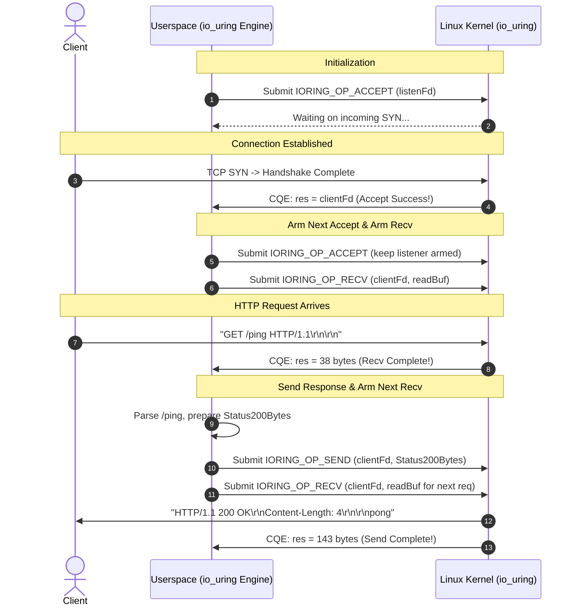

# io_uring Deep Dive: Architecture, Memory-Mapped Rings, and Asynchronous Linux I/O

This document provides a comprehensive theoretical and architectural breakdown of **`io_uring`**, Linux's modern high-performance asynchronous I/O interface introduced by Jens Axboe in Linux 5.1.

---

## 1. The Architectural Evolution: From Readiness to Completion

To understand why `io_uring` was created, we must compare the two fundamentally different I/O paradigms in operating systems:

```
┌────────────────────────────────────────────────────────────────────────┐
│                        READINESS (epoll)                               │
├────────────────────────────────────────────────────────────────────────┤
│ 1. Userspace asks kernel: "Which descriptors are ready for I/O?"       │
│ 2. Kernel returns list of ready FDs via epoll_wait().                  │
│ 3. Userspace must issue synchronous syscalls (read / write) per FD.    │
│    --> Syscall Tax: Minimum 2N + 1 syscalls per N requests!            │
└────────────────────────────────────────────────────────────────────────┘

┌────────────────────────────────────────────────────────────────────────┐
│                       COMPLETION (io_uring)                            │
├────────────────────────────────────────────────────────────────────────┤
│ 1. Userspace tells kernel: "Read 1KB from FD into this buffer."        │
│ 2. Kernel performs the I/O asynchronously in the background.           │
│ 3. Kernel posts a completion notification: "Done: 1024 bytes read."    │
│    --> Zero Syscall Execution: Shared memory rings eliminate syscalls. │
└────────────────────────────────────────────────────────────────────────┘
```

### Why `epoll` Hit a Ceiling
1. **The Syscall Tax**: `epoll` is merely a *readiness notifier*. Once `epoll_wait` reports that FD 7 is readable, userspace must execute a synchronous `read(7, buf, len)` syscall. Each syscall triggers a CPU privilege transition (user $\to$ kernel $\to$ user), flushing CPU pipeline state, causing TLB and register context switches.
2. **Spectre & Meltdown Overhead**: Hardware mitigations (KPTI — Kernel Page Table Isolation) increased the CPU cycle cost of every user/kernel transition by 30% to 100%.
3. **No Support for Disk I/O**: `epoll` cannot poll regular files on disk — regular file descriptors always report as "ready", meaning file I/O on Linux was historically forced to block or rely on `posix_aio` (which uses internal pthreads and has notorious limitations).

---

## 2. The Core Foundation: Shared-Memory Ring Buffers

`io_uring` solves the syscall overhead by placing **two circular ring buffers in shared kernel-user memory**:
1. **Submission Queue (SQ)**: Userspace writes requests (SQEs) into this ring; the kernel consumes them.
2. **Completion Queue (CQ)**: The kernel writes completed results (CQEs) into this ring; userspace consumes them.

```
       USERSPACE                                    KERNEL
 ┌──────────────────────┐                   ┌──────────────────────┐
 │                      │                   │                      │
 │   SQ Tail (User +)   │ ────── mmap ────> │   SQ Head (Kernel -) │
 │                      │                   │                      │
 │   CQ Head (User -)   │ <───── mmap ───── │   CQ Tail (Kernel +) │
 │                      │                   │                      │
 └──────────────────────┘                   └──────────────────────┘
             ▲                                         │
             │           ZERO SYSCALL INTERACTION      │
             └─────────────────────────────────────────┘
```

Because these ring buffers reside in memory mapped by both userspace and the kernel (`mmap(2)`):
* Userspace can submit work **without making any syscalls** by updating the SQ tail pointer.
* Userspace can harvest completed events **without making any syscalls** by reading CQEs and updating the CQ head pointer.
* A single syscall (`sys_io_uring_enter`) is only required when the application needs to notify the kernel or wait for completions.

---

## 3. The 3 Linux Syscalls of `io_uring`

Unlike complex legacy interfaces, `io_uring` exposes only three raw system calls:

### Syscall 1: `sys_io_uring_setup` (Syscall #425 on x86_64)
```c
int io_uring_setup(u32 entries, struct io_uring_params *params);
```
* **Purpose**: Creates an `io_uring` instance with capacity for `entries` (must be a power of 2, e.g., 512, 1024).
* **Return**: A file descriptor representing the ring.
* **The Params Struct**: The kernel returns exact byte offsets (`sq_off` and `cq_off`) indicating where `head`, `tail`, `mask`, and entries are positioned in memory.

### Syscall 2: `sys_io_uring_enter` (Syscall #426 on x86_64)
```c
int io_uring_enter(unsigned int fd, unsigned int to_submit,
                   unsigned int min_complete, unsigned int flags,
                   sigset_t *sig);
```
* **Purpose**: Submits `to_submit` pending SQEs to the kernel, and optionally blocks until `min_complete` events have completed.
* **Flags**:
  * `IORING_ENTER_GETEVENTS`: Tells the kernel to wait for `min_complete` completions.
* **Dual Action**: Can submit **and** wait in a **single syscall**, cutting context switches in half.

### Syscall 3: `sys_io_uring_register` (Syscall #427 on x86_64)
```c
int io_uring_register(unsigned int fd, unsigned int opcode,
                      void *arg, unsigned int nr_args);
```
* **Purpose**: Registers resources (such as fixed file descriptors or pre-pinned userspace memory buffers) directly with the kernel.
* **Benefit**: The kernel holds persistent references, avoiding per-I/O page table pinning (`get_user_pages`) and file descriptor reference count atomic updates.

---

## 4. Memory Layout & Struct Alignments

### 1. Submission Queue Entry (`struct io_uring_sqe`) — Exactly 64 Bytes
Every operation submitted to `io_uring` is described by a 64-byte SQE:

```text
 0x00: [ opcode (1B) ][ flags (1B) ][ ioprio (2B) ][ fd (4B) ]
 0x08: [ off / addr2 (8B)                                    ]
 0x10: [ addr / splice_off_in (8B)                           ]
 0x18: [ len (4B)          ][ rw_flags / accept_flags (4B)   ]
 0x20: [ user_data (8B: Tag / pointer / connection ID)       ]
 0x28: [ buf_index/buf_group (2B) ][ personality ][ file_idx ]
 0x30: [ __pad2[0] (8B)                                      ]
 0x38: [ __pad2[1] (8B)                                      ]
 Total: 64 Bytes (Cache-line aligned)
```

Key Fields:
* `opcode`: The operation to perform (e.g., `IORING_OP_ACCEPT = 13`, `IORING_OP_RECV = 27`, `IORING_OP_SEND = 26`, `IORING_OP_CLOSE = 19`).
* `fd`: Target socket or file descriptor.
* `addr`: Buffer memory address (pointer passed as a 64-bit unsigned integer).
* `len`: Number of bytes to read or send.
* `user_data`: An opaque 64-bit tag. The kernel **echoes this exact 64-bit value back** in the completion entry (`cqe->user_data`). This lets us correlate completions with client state without hash maps!

### 2. Completion Queue Entry (`struct io_uring_cqe`) — Exactly 16 Bytes
Every completed operation produces a 16-byte CQE:

```text
 0x00: [ user_data (8B: Echoed from SQE)                    ]
 0x08: [ res (4B: Return code or bytes transferred)          ]
 0x0C: [ flags (4B)                                         ]
 Total: 16 Bytes
```

Key Fields:
* `user_data`: Identifies which request completed.
* `res`: The operation result. Equivalent to a syscall return value:
  * For `read`/`recv`: Number of bytes received, `0` for EOF, or `-errno` (e.g., `-EAGAIN`, `-ECONNRESET`).
  * For `accept`: The new client file descriptor (`nfd`), or `-errno`.
  * For `send`/`write`: Number of bytes sent.

---

## 5. Ring Memory-Mapping Architecture

When `io_uring_setup()` succeeds, the kernel allocates ring memory. In modern kernels ($\ge 5.4$), `IORING_FEAT_SINGLE_MMAP` allows mapping both SQ and CQ rings in a single mmap call:

```go
// 1. Map SQ ring + CQ ring (Single MMAP)
sqRingSize := sq_off.array + sq_entries * 4
cqRingSize := cq_off.cqes + cq_entries * 16
ringSize := max(sqRingSize, cqRingSize)

ringPtr, err := unix.Mmap(ringFd, IORING_OFF_SQ_RING, ringSize, PROT_READ|PROT_WRITE, MAP_SHARED|MAP_POPULATE)

// 2. Map SQE Array (64 bytes * sq_entries)
sqeSize := sq_entries * 64
sqePtr, err := unix.Mmap(ringFd, IORING_OFF_SQES, sqeSize, PROT_READ|PROT_WRITE, MAP_SHARED|MAP_POPULATE)
```

### The Submission Queue Indirection Layer
The SQ ring has an extra array of 32-bit integers (`sq_off.array`). Userspace places SQEs in the flat SQE array at index `i`, and writes `i` into `sq_ring->array[tail & mask]`. This allows the kernel to consume SQEs in arbitrary order if needed.

---

## 6. Lock-Free Atomic Coordination & Memory Barriers

To coordinate between userspace and kernel without mutex locks, `io_uring` uses **single-producer, single-consumer ring buffers** guarded by acquire/release memory barriers:

```
               SUBMISSION QUEUE (SQ)
 Producer: Userspace          Consumer: Kernel
 ────────────────────         ──────────────────
 1. sqe = &sqes[tail & mask]
 2. Fill sqe fields
 3. array[tail & mask] = index
 4. StoreRelease(&sq_tail, tail + 1)
                              5. LoadAcquire(&sq_tail)
                              6. Process SQEs
                              7. StoreRelease(&sq_head, head + N)

               COMPLETION QUEUE (CQ)
 Producer: Kernel             Consumer: Userspace
 ──────────────────           ────────────────────
 1. Write CQEs
 2. StoreRelease(&cq_tail, tail + N)
                              3. LoadAcquire(&cq_tail)
                              4. Read CQEs
                              5. StoreRelease(&cq_head, head + N)
```

In Go, we implement these memory semantics using `sync/atomic`:
* Read kernel tail: `atomic.LoadUint32((*uint32)(unsafe.Pointer(cqTailPtr)))` (Acquire)
* Advance user head: `atomic.StoreUint32((*uint32)(unsafe.Pointer(cqHeadPtr)), newHead)` (Release)

---

## 7. HTTP Server Lifecycle in `io_uring`

Here is how a high-throughput HTTP server processes traffic using `io_uring`:



### Key Differences from `epoll`:
1. **Zero Intermediate Syscalls**: When the `RECV` CQE arrives, data is **already in userspace memory**. There is no call to `unix.Read()`.
2. **True Asynchronous Writes**: When sending the HTTP response, the application submits `IORING_OP_SEND`. The kernel handles socket buffer backpressure without `EAGAIN` retry loops in userspace.
3. **Batched Submissions**: Multiple operations (`ACCEPT`, `RECV`, `SEND`) can be queued simultaneously and dispatched with a single call to `io_uring_enter`.

---

## 8. Syscall Budget Comparison: 10,000 HTTP Requests

| Operation | `net/http` (Goroutines) | `epoll` (Reactor Loop) | `io_uring` (Batch Ring) |
|:---|:---|:---|:---|
| **Wait for Events** | Netpoller internal | 1 × `epoll_wait` per batch | 1 × `io_uring_enter` per batch |
| **Accept Sockets** | Synchronous `accept4` | Synchronous `accept4` | Asynchronous `IORING_OP_ACCEPT` |
| **Read HTTP Data** | Synchronous `read` | Synchronous `read` | **Zero syscalls** (Kernel DMA to buffer) |
| **Write Response** | Synchronous `write` | Synchronous `write` | **Zero syscalls** (Queued in SQ) |
| **Context Switches** | Very High (1 goroutine/conn) | Low (Single thread) | **Lowest** (Batched kernel polling) |
| **Syscalls per Request** | $\ge 2$ | $\ge 2$ | **$\approx 0.05$ – $0.1$** (Batched in SQ) |

This zero-syscall capability is the ultimate architectural promise of `io_uring`.
